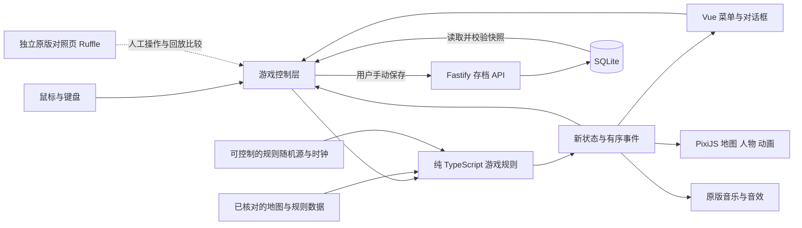

# 新架构设计

状态：供第一阶段验收；模块职责和边界已提出，尚未实现。依据见 [原版分析](phase-1-findings.md)。

## 目标与选择

采用 TypeScript + PixiJS 8 + Vue 3 + Vite；后端采用受支持的 Node.js LTS + Fastify + SQLite。实施时验证并锁定具体版本和运行环境，不追逐夜间版。保留当前 Vue 工程与锁文件的管理方式。

PixiJS 提供二维场景树、纹理、事件和 WebGL/WebGPU 渲染能力，适合保留原版的预渲染二维外观。[官方架构说明](https://pixijs.com/8.x/guides/concepts/architecture)

首批优先验证 WebGL 渲染；WebGPU 是可选后端，不是成功标准。无需重建三维模型，也不需要多人网络同步、微服务或一个通用 Flash 模拟器。

后端只管理单用户访问和手动存档。Fastify 提供路由、验证和 TypeScript 支持；SQLite 事务用于保证一次存档整体写入。[Fastify 文档](https://fastify.dev/docs/latest/) · [SQLite 事务保证](https://www.sqlite.org/transactional.html) · [Node.js 支持周期](https://nodejs.org/en/about/previous-releases)

## 数据流



## 必须维持的边界

| 模块 | 负责 | 禁止的依赖或行为 |
|---|---|---|
| 游戏规则 | 玩家状态、回合、移动路径、土地、卡牌、事件、AI 决策、结算 | 不依赖 Vue、PixiJS、DOM、fetch；不直接调用 Date.now 或 Math.random |
| 游戏控制层 | 接收命令、拒绝重复操作、推进规则流程、调度表现、生成快照 | 不重新实现租金或卡牌公式 |
| 地图与动画 | 坐标、遮挡、镜头、帧动画、光效、命中区域 | 不直接增减金钱、改变产权或决定骰点 |
| 菜单与对话框 | 展示原版信息与选择项，将选择交给控制层 | 不持有第二份权威游戏状态 |
| 音频 | 依游戏事件播放原音乐和音效、音量控制、音乐衔接 | 不以音频播放结束决定业务结果 |
| 存档服务 | 验证版本与数据、事务写入、读取、单用户访问控制 | 不在客户端每次状态变更时自动写盘，不要求联网才能掷骰 |
| 原版基准 | 重现原程序、保存比较证据 | 不被现代入口作为引擎、隐藏 iframe 或运行时脚本解释器调用 |

## 原版时序怎样迁移

原版 `run()` 由根时间轴调用，依赖 `sport_id / begin_id / end_id / tenor_id / show_id` 等共享变量；骰子、建房、提示框在各自时间轴写回这些变量。

新版把这些隐式协作转成有名称的流程状态，例如“等待行动、展示掷骰、逐格移动、途中事件、落地事件、等待选择、回合结束、游戏结束”。完整枚举在阶段 2B 按真实调用链确定。

- 骰点由规则层产生一次，视觉骰子可以播放原时长，但不能反复生成业务骰点。
- 地图位置在规则层用网格或节点 ID 保存；像素位置由渲染层插值，避免用像素浮点相等判断落地。
- 规则时钟与显示刷新分开。原动画用 30 fps 采样节奏，浏览器可以更高频率绘制；切换快慢速度只改变表现时长。
- 视觉随机源与规则随机源分开，云朵、表情和提示语不再改变下一次掷骰。由于原版共用随机调用，不能用“相同 seed”直接声称与原版逐步一致；原版比较须控制或记录语义随机结果。
- 表现完成信号只推进已安排的呈现步骤，不重复提交钱款和产权变化。后台标签页、跳帧或重复点击不得造成重复扣款。
- 核心可以在没有浏览器的测试环境中完成回合和结算；这也是判断是否真正迁移了架构的条件。

## 资源管线

1. 原始 SWF 是离线资料，不修改，不随新版入口加载。
2. 固定版本的离线提取工具输出地图 PNG、透明图片、音频、动画帧与锚点/包围盒/原始 ID。
3. 图片以“原始文件 + 定义 ID + 动作/方向”关联，不能只凭文件名猜角色或动画。
4. 原版地图底图可先整体使用；动态地块、角色公司、NPC、人物、特效单独管理。原网格坐标与图像坐标的对齐必须实测。
5. 帧图集打包时保留 trim 与 pivot；每帧不能各自居中，否则行走会抖动。对半透明阴影、位图颜色变换、遮罩和混合模式分别检查。
6. 高清资源沿用相同逻辑尺寸与锚点。换图只更新资源映射，不修改规则；之前的生成式样张仍是候选，不自动升级为最终美术。

## 存档设计边界

只支持新版手动存读档。沿用原版“三个槽位”作为阶段 4 的默认方案，用户验收前可调整。

快照至少包含：格式版本、规则版本、创建/保存时间、玩家与控制类型、当前回合和可恢复流程状态、地图和产权、资产与持股、卡牌与状态持续时间、NPC/障碍、游戏日期、规则随机源状态。具体字段在完整核心稳定后确定。

后端不保存 Pixi 对象、Vue 响应式对象、动画实例或原版数组的临时引用。通过事务整体替换指定槽位；带槽位修订号检测多标签页覆盖。只有服务器确认写入后显示成功；失败时保留当前局并允许用户手动重试，不偷偷转为自动保存。

手动保存入口的可用时机以原版菜单行为为基准，优先限定在稳定的等待操作状态；禁止保存与新命令同时修改同一快照。读取时先完成格式、版本、引用和数值校验，再整体替换当前局，避免半份状态生效。

个人服务器部署前增加单用户登录；具体凭据与 HTTPS 在阶段 6 确认，本地阶段使用同样的 API 与数据库验证。SQLite 数据卷独立于代码和镜像。

## 代码组织建议

```text
src/modern/
  domain/             状态、规则与确定性转换；无浏览器依赖
  application/        命令、流程调度与手动存读档编排
  features/map/       地图数据适配、坐标与地图呈现
  features/characters/ 动作映射与人物呈现
  presentation/       游戏画面、菜单与声音
  data/               经核验并生成的规则数据
  ModernApp.vue       现代版独立入口
server/               第四阶段新增存档 API 与 SQLite 持久化
public/modern/        离线导出的原版资源，随后逐批更换高清版本
tests/modern/         核心行为、边界与无渲染测试
tests/e2e/modern-*.spec.ts  真实浏览器交互与视觉验证
docs/modernization/  证据、差异、阶段验收记录
```

当前 `src/core/`、`src/render3d/` 是早期自绘版本，不能直接当作等价实现；仅在逐条证明规则一致后考虑复用小段通用代码。原版入口与现代入口分开构建依赖，现代入口不得请求 `ruffle`、`.swf` 或导入旧引擎。

## 验证原则

核心规则用原始表格、源码分支和手算样例建立行为测试；复杂机制逐项增加原版操作证据。渲染用原素材并排检查位置、遮挡、方向和节奏。原版 Bug 建立“原行为、证据、修正行为”三列记录，按确认结果验收差异。

每批只运行与变化相关的检查。旧引擎已有的 54 个测试不能证明现代核心正确。没有覆盖的事件、角色动作、存档状态和浏览器应明确列为未验证，而不是用笼统的“100% 复刻”代替证据。
