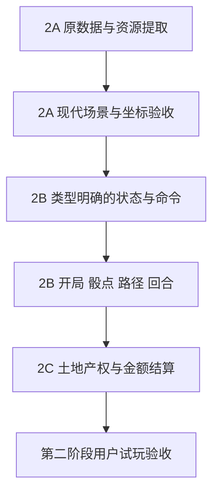

# 分阶段改造与验收计划

日期：2026-09-12。目标、设备、存档与美术边界见[验收包首页](README.md)，架构职责见[设计](architecture.md)。

## 推进规则

每一批先补齐该批原版证据，再实施，再运行针对性检查，最后给用户实际结果验收。用户通过后才进入下一批。发现遗漏时修正当前批的规格，不用下一阶段掩盖当前差异。

第一阶段的13,379行反编译结果是资料，不是待机械翻译的任务量。工作量主要取决于分支、状态组合和视觉一致性；在第二阶段跑通第一批之前不提供看似精确的总工期。

| 阶段 | 批次 | 本批交付 | 验收与退出条件 |
|---|---|---|---|
| 1 原版分析 | 1A 当前 | 功能、数据、动画样本、架构设计、风险与后续计划 | 数据可追溯、未知项明确；用户认可范围与架构，不要求新版已能玩 |
| 2 最小对局 | 2A 原素材场景 | 独立现代入口、原版地图底图和地块数据、四向人物行走展示、镜头与缩放 | 现代入口不加载SWF/Ruffle；地图与标记对齐，人物透明/锚点/方向正确；只验场景，尚不是完整对局 |
| 2 最小对局 | 2B 开局与回合 | 12角色选人、AI补位、出生区、骰子、逐格移动、普通路口、回合交替 | 指定骰点可达预期格；路径、方向和步数一致；快慢模式不改变最终状态 |
| 2 最小对局 | 2C 买地收租 | 无人地购买、升级、同街道合计租金、现金/存款转移、基础资产显示 | 完成至少人类与AI各一轮；购买/放弃/不足款/自有地/敌方地均可验证；特殊地点明确保留为下一阶段范围，不能冒充完整游戏 |
| 3 完整玩法 | 3A 卡牌与事件 | 16种常规卡池逐类、其他可达卡入口、商店、41运气事件、奖券格 | 每张已开放卡有触发、取消、目标限制和结算样例；不擅自开放原版未开放定义；复现并处理B-01 |
| 3 完整玩法 | 3B 金融与公司 | 银行存取款/贷款/月结、股票、角色公司/董事权、相关AI | 金额/持股守恒，边界条件明确，逐步对照原版；不将股价表的所有16行都视为同类股票 |
| 3 完整玩法 | 3C NPC与特殊地点 | 神灵/障碍/地雷、魔法门、医院/监狱、法院、彩票、游乐场、失物招领 | 状态持续回合、移动中断、入出场动画与费用一致；对定义存在但不可达内容有明确处理记录 |
| 3 完整玩法 | 3D 整局与边界 | 破产与资产回收、胜负、托管、日历、速度、地图查看、全部音乐音效 | 完成整局；过日/跨月/跨年与淘汰路径通过；逐项解释B-02…B-05；本批结束才称完整玩法 |
| 4 存读档 | 4A 原子快照 | 本地后端、SQLite、三个手动槽位、新版格式 | 手动保存成功后刷新、关页、重启后端仍能读回同一局；全部核心字段与随机状态恢复 |
| 4 存读档 | 4B 故障与保护 | 格式/版本校验、写入失败、并发标签页覆盖检测、单用户保护 | 不完整快照不生效，失败不误报成功，不自动保存，旧槽位不因写失败损坏；跨浏览器读取同一服务器存档 |
| 5 高清化 | 5A 风格与底图 | 原版约束下的地图高清样本与1角色完整普通动作样本 | 比较轮廓、五官比例、颜色、固定建筑位置与连续帧稳定性；用户确认这一批再扩大 |
| 5 高清化 | 5B 分组替换 | 角色、公司建筑、住宅等级、NPC、特效、界面分组升级 | 每组原图对照，方向/锚点/遮挡不变；高清开关不改变任何规则测试结果 |
| 5 高清化 | 5C 整体画面 | 1080p窗口与全屏、高清文本、完整美术覆盖清单 | 无明显原/新素材突变、动画闪变、缺图、黑边；未升级内容明确列出，不能以画布分辨率宣称素材全高清 |
| 6 部署 | 6A 上线前本地验收 | 最终本地构建、部署说明、数据库卷/备份、健康检查、回退方案 | 用户验收完整本地版本；确定服务器/域名后形成具体部署动作 |
| 6 部署 | 6B 服务器验收 | 同一已验收版本、HTTPS、单用户访问、持久化数据 | 真实访问、开局、手动存读档、服务重启、备份恢复通过；未获部署阶段确认前不触碰服务器 |

## 第二阶段的实现依赖

规则核心从2B起独立于渲染器。2A的动作样本不参与规则执行；2B接入时由规则事件选择动作。禁止为了让第一张截图好看，把业务再次塞进渲染循环。

## 每批交付的固定内容

1. 本批新增能力和明确未包含的能力。
2. 可点击的本地入口或可检查的资料；阶段2之后必须有真实可交互结果。
3. 对应原版源码/数据/操作证据，以及对照结果。
4. 本批相关自动化检查和人工试玩结果，失败与未运行项单列。
5. 变更文件、提交/分支状态、回退方式。
6. 用户验收记录：通过、需修改或范围调整。未收到通过时不开展依赖该批结果的下一批实现。

## 核心验收样例

| 编号 | 场景 | 期望 |
|---|---|---|
| R-01 | 相同开局输入与可控随机结果 | 角色、出生位置、资产、当前回合一致 |
| R-02 | 30/60/120次显示刷新下执行同一组命令 | 最终核心状态一致；只允许表现插值不同 |
| R-03 | 途中路障、落地事件、确认/取消 | 只扣一次步数、只结算一次、流程不会卡死 |
| R-04 | 买1500地价的无人地 | 现金减少1500、产权与同街道索引同步 |
| R-05 | 同一街道两地等级0/1且地价均1500 | 普通路费1800，现金不足部分由存款承担，地主收存款 |
| R-06 | 原版存在确认Bug | 原行为能复现，修正测试先失败后通过，差异记录明确 |
| R-07 | 手动保存后关闭浏览器并重启本地服务 | 加载后的玩家、地图、资产、卡牌、状态、日期和随机状态匹配 |
| R-08 | 存档请求失败或格式损坏 | 当前局继续保留，旧存档不损坏，不显示保存成功 |
| R-09 | 换高清资源 | 同一命令记录的核心结果不变；仅视觉变清晰 |
| R-10 | 现代入口加载 | 无SWF、Ruffle、旧规则引擎依赖；核心在无DOM环境也能执行 |

这张表是计划中的验收场景，不表示已有新版测试全部实现或通过。

## 变更控制

- 修复Bug不自动包含改平衡、加新卡、增强AI、改地图、改音乐等设计变更。
- 手机适配、网络多人、账号注册体系、云端对局计算不在当前范围。
- 自动存档和旧存档兼容明确不做。
- 新版存档槽位默认沿用原版三个；其他UX细节在第4阶段局部设计时确认，不为这些非阻塞项提前停工。
- 架构设计通过后，先实施2A。2B及之后只在前一批验收后细化其实施计划，避免在未知规则上写一份假精确的巨型计划。
