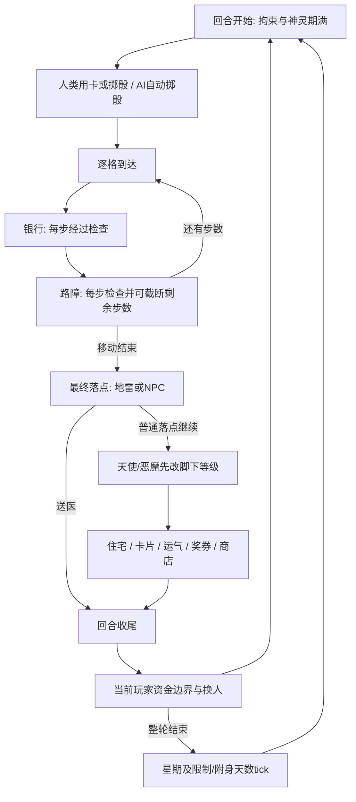

# 3A 完整对局接入设计

用户已授权进入下一阶段直到完成。本阶段完整目标仍为16种常规卡、额外信用卡入口、商店、41运气事件、奖券和必要世界依赖；纯模块或原图导出均不代替完整可玩交付。2C回退点204ded9，所有代码保留本地独立分支，不合并、推送或部署。

## 单一规则状态

GameState组合WorldSnapshot已有玩家、产权、动态地价、手牌、信用、控骰/停留、奖券、失物招领和world字段，继续保留原回合、移动、物业确认字段。创建对局时注入一次本地星期；无DOM纯规则不调用Date或Math.random。素材重试使用同一个完整待定开局，不重新抽NPC/阵容/星期。普通出生路线与人物不改，新增NPC放置消耗明确规则随机值，因此新版种子轨迹需重新建立真实回放，不能为保留旧测试路线而去掉新规则抽样。

新增单个interaction阶段，内部使用明确的可辨识联合数据：卡确认、选骰、选目标、信用金额、商店、银行、结果/限制提示。每个待确认交互包含有限的继续位置标识，而不是把闭包当快照状态。现有property-decision/property-result继续负责住宅确认。实际卡面、价格、库存和资产来自规则状态；页面不能提交价格、金额增减或任意隐藏测试状态。

控骰/停留必须按原全局标志串联：成功应用卡5后规范化forcedDice只保留最后设置者的一项，下一个实际掷骰者（包括AI）消费并清全部；成功卡27后stayPlayerIds只保留最后设置来源，下一个正常人类移动消费并清空，AI不消费。取消/非法选择不得清掉旧效果。这个状态形式保留现有纯卡接口，但不能按设置者ID限制使用；需专门回归“控骰/停留后飞弹自伤提前结束回合”的跨玩家场景。

控制器显式投影WorldSnapshot给纯模块，再把返回核心字段并入当前GameState，避免纯模块克隆了无关UI事件导致旧交易被再次记日志。交易日志在真实结算提交时仅追加一次，不因暂停、变速、属性面板重绘或对象引用变化重放旧记录。

## 回合与移动次序

- 路障移除后还要处理脚下普通落点；地雷只在最终落点触发，送医院并结束回合。经过地雷不引爆。普通NPC也是最终落点才遭遇。
- 银行在路径中间也打开；处理完必须回到“该格银行之后”，不能再次检查同一银行或漏掉同格路障。人类周日关闭；AI信用申请沿用其独立源码条件。只提供本批信用卡申请入口，其他金融业务明确属于3B。
- 神灵自然遭遇后在同一格立即影响随后地产；招神卡本身不补跑脚下地产。天使/恶魔免费变级只在一次落地流程中执行一次，不在报价函数或重复确认里执行。
- 新回合先判断住院/拘留。剩余日数>0则显示/AI自动略过；为0时从已有医院/监狱坐标恢复，再处理到期附身。每完整轮次只tick一次。
- 资金耗尽只在真实回合收尾检查当前玩家。普通卡片结算不自动终止回合；购地卡透支后可继续合法信用提款等操作。卡导致本人住院/拘留时进入收尾。3A继续停在明确待破产边界，不冒充完整淘汰。

## 用卡、商店与确认

人类只有自己的正常待掷骰阶段能发起用卡。先显示原卡名/说明与确认/取消；需要点数、金额或目标时进入相应选择。尚未提交的选择可取消返回，手牌与资金不变（现代界面的可逆退出，不改原成功/失败消耗规则）。失败目标明确提示，卡保留；提交成功后只结算并消耗一次。信用卡成功不消耗；送神无神仍消耗。AI不凭空增加出牌策略。

地图目标由原getpoint的网格/象限规则转换，纯模块最终检查是否合法。目标点击与拖动区分，拖地图不会同时用卡；玩家目标可提供按真实位置选择姓名的辅助入口。确认快捷键仅在对应交互生效，表单焦点时不截获方向键；不能在选择金额时误掷骰。

卡片屋一次生成固定6槽+随机6槽；失败重试/重绘不刷新库存。买、卖、失败结果清楚显示奖券、手牌与货架状态。每笔结果确认前禁重复提交，出售同ID多张也按实际槽位一次移除。AI只是经过，不生成商店随机库存。离店保留已完成交易。

卡片格、41运气和10/30/50奖券格均使用实际38个可达特殊格目录。结果确认只推进流程，不能再次抽卡/抽事件/加奖券。满24卡不推进抽卡随机源。事件28显示捐款且实际扣1000，并保留B-01差异记录。

## 原素材与界面

所有交互都在game-stage内，真实全屏仍能操作。右侧对局面板保留当前玩家、资产、路径、日志，增加当前手牌（原卡面和明确名称，8张分页可容纳24张）、奖券、信用与限制/附身天数。25/26原卡图相同但名称必须区分。

地图在共享深度中绘制原NPC、四向路障、地雷、中立房屋；不能把无主房屋画成某个玩家颜色。六神地图与附身状态单一实例；其他原初始NPC保持原外观/占位，遭遇明确标为3C未接入，不能静默宣称全部NPC完成。人物反馈按原帧数30fps一次播放并停末帧，移动用已有行走；神灵/地雷等源循环按各自周期。嵌套火箭、爆炸、卡片/奖券获得效果使用对应原序列，不能只显示父第一帧。

素材加载继续使用可取消的私有生命周期，释放全部bitmap/texture/listener；只加载本局四位角色的反馈动作。原卡图/事件插图用于Vue面板，不为未使用的HTML图片创建冗余Pixi纹理。对失败资源显示可定位错误并重试同一完整开局。若首次装载耗时明显，优先按可见角色/实际用途控制请求，而不是删掉源动画以通过测试。

## 验证与交付范围

先为控制器新分支写失败回归，覆盖所有交互的重复、取消、暂停、重开、变速、AI自动确认、银行中途恢复、路障与地雷差别、每日倒计时、同格神力再地产、资金透支后合法用卡恢复，以及现有2B/2C流程。

每种开放卡均有真实规则/组件的触发、取消、目标限制、结算样例；可用独立浏览器测试fixture覆盖难以自然达到的边界，但须与生产入口自然回放分开标注，不在产品加入调试全局或任意发卡。生产入口必须真实完成选人→手牌用卡→移动/特殊落点→AI→商店买卖→信用取得/使用等代表性链路，核对可见资金/牌数/世界状态。建立新种子场景，保留旧物业/移动的核心断言，不靠删除失败检查适配。

最终运行相关全量单元、类型、现代构建、生产浏览器回放与1440×1000/1920×1080真实全屏目视检查，检查无SWF/Ruffle请求与资源错误；原版未改则复用原版验证证据。独立整体审查覆盖所有子模块组合，修复真实问题后给用户完整3A验收入口与精确范围。当前此文只是接入设计，不代表已经实施。
